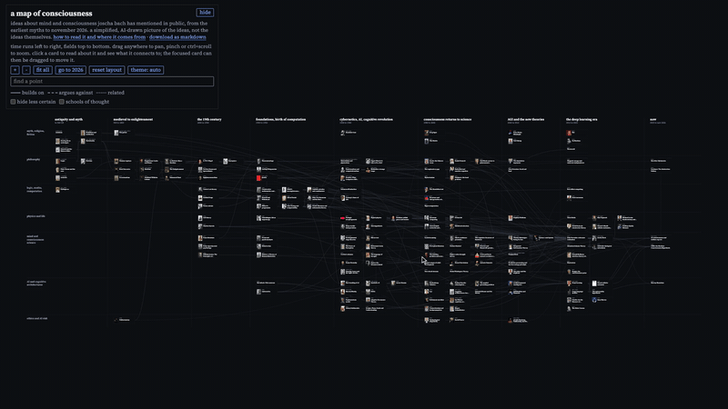

# a map of consciousness

ideas about mind and consciousness joscha bach has mentioned in public, from the earliest myths to november 2026. unofficial.

**[open the map](https://maxeozakh.github.io/bach-map/)** · [how to read it and where it comes from](https://maxeozakh.github.io/bach-map/about.html)

click the preview for the full film (1080p, 60 fps, no sound).

## what's here

- `index.html`, `about.html`: the site, static, no dependencies
- `build.py`, `nodes.py`, `edges.py`, `board_template.html`, `about_template.html`: `python3 build.py` regenerates the pages
- `research/`: the transcripts and notes the selection of points came from
- `video/`: the film and the scripts that render it frame by frame from the real page
